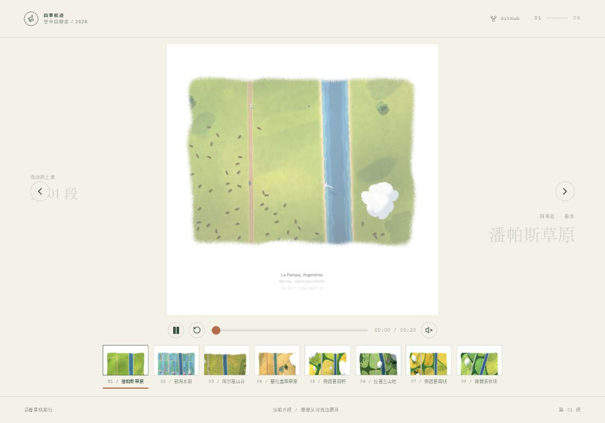
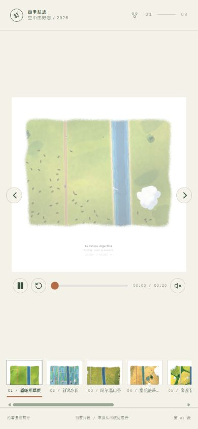

# 四季航迹 · 空中田野志

一个以原始航拍影像为主视觉的中文友好互动网页。页面把 6 个视频素材整理为 8 个可浏览章节，保留视频中的手绘、水彩和航拍动画，并加入场景切换、胶片缩略图、章节叙事、进度拖拽和本地背景音乐。

## 在线体验

- Demo：<https://seasonal-flight-atlas.vercel.app>
- GitHub：<https://github.com/1byteone/seasonal-flight-atlas>

## 效果预览

### 桌面端



### 移动端



## 本地运行

```bash
npm install
npm run dev
```

生产构建：

```bash
npm run build
npm run preview
```

## 交互说明

- 播放、暂停、重播和拖动当前片段进度。
- 使用左右箭头或底部胶片缩略图切换章节。
- 鼠标悬停缩略图时预览对应片段。
- 场景切换时显示章节札记，并重新播放地点故事文字的入场动画。
- 点击声音按钮开启或关闭本地背景音乐，切换场景时会交叉淡入淡出。
- 页面右上角 GitHub 图标可打开本项目公共仓库。

## 目录结构

```text
.
├─ docs/screenshots/       # README 使用的桌面端与移动端截图
├─ public/atlas/           # 视频、章节海报和清理过鼠标的合成视频
├─ public/assets/audio/    # 页面实际使用的本地 MP3 与授权清单
├─ src/components/         # 视频播放器组件
├─ src/data/               # 8 个章节的地点、季节、文案和片段边界
├─ src/main.tsx            # 页面状态、章节切换和声音编排
├─ src/styles.css          # Swiss Editorial × Aerial Documentary 视觉与动效
├─ index.html
├─ vercel.json
└─ package.json
```

原始 6 个视频保留在本机 `asset/` 目录中，公共仓库只提交网页运行所需的优化素材。第 6 个组合视频拆为三个章节：拉普兰、旁遮普南线和诺曼底。

## 部署到 Vercel

项目已经包含 `vercel.json`，Vercel 会自动使用以下配置：

- Framework Preset：Vite
- Build Command：`npm run build`
- Output Directory：`dist`

当前生产 Demo 为 <https://seasonal-flight-atlas.vercel.app>。项目已关闭 Vercel 登录保护，访客无需登录即可浏览视频、海报和音频资源。

## 音频授权

音频授权与来源记录在 [`public/assets/audio/music-manifest.json`](public/assets/audio/music-manifest.json)。其中 CC BY 4.0 曲目在页面中使用时需要保留作者署名，CC0 曲目无需署名。

## 技术栈

- React 19
- TypeScript
- Vite
- lucide-react
- 原生 CSS 动画与 SVG 水彩位移滤镜
